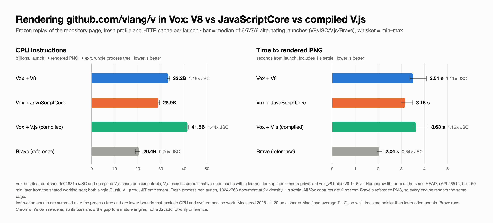

# github.com/vlang/v: Vox with V8, JavaScriptCore and compiled V.js

Measured 2026-11-20 with `tools/benchmark_github_page.py` (engines
`libjs-native jsc v8 brave`). Each launch was a fresh process with a fresh
profile and HTTP cache. It loaded the frozen original-origin replay
(`libjs-page-engines-20261117-5204-r52`) and ran to GitHub's hydrated
content, a 1 s settle, a 1024×768 document PNG at 2× density, the audit and
process exit. Engine order alternated each round.

| Engine | Valid launches | Instructions, median (min–max) | PNG available, median (min–max) |
|---|---|---|---|
| Vox + V8 | 6 | 33.24B (32.62–33.84) | 3.51 s (3.37–4.09) |
| Vox + JavaScriptCore | 7 | 28.89B (28.79–29.51) | 3.16 s (2.99–3.49) |
| Vox + V.js (compiled) | 7 | 41.53B (40.55–41.96) | 3.63 s (3.51–4.15) |
| Brave (reference) | 6 | 20.35B (18.94–21.01) | 2.04 s (1.95–2.17) |

Relative to Vox + JavaScriptCore, V8 needs 1.15× the instructions and compiled
V.js 1.44×. Brave's V8 `ScriptDuration` median was 194 ms.

## Builds

- JSC and V.js (LibJS) share the published bundle `fe01881e…` (HEAD `c62b26514`,
  `-b c`, a single C unit, V `-prod`). V.js used the grouped native-code
  cache prepared for that executable by `tools/prepare_github_grouped_cache.py`,
  with its lookup index learned in three untimed visits and then read-only.
- V8 used a private `VOX_V8=1` build of the same HEAD, built about 50 minutes
  later from the shared working tree (other sessions' uncommitted edits can
  differ). It used the same backend, C mode, `-prod` and JIT entitlement, and
  linked V8 14.6.202.34 from Homebrew's libnode. Every V8 launch printed the
  `Vox V8 backend` diagnostic.

## Validity and limits

- Every Vox capture differs from Brave's reference PNG by 2 pixels, so all
  three engines rendered the same page. All Vox launches passed the content
  audit and verified engine execution.
- Brave's first launch differed from the reference in a faint 646×42 strip
  (maximum channel error 9). The other five Brave launches matched the
  reference exactly, but the driver's same-engine check compares them with
  the first one and flagged them. Their loads and counts are complete and
  included above.
- The seventh round's V8 launch completed (34.00B, 3.24 s), but the pixel-diff
  tool it pinned was deleted during the run, so it is excluded. That round's
  Brave launch did not run.
- Instruction counts are polled process-tree sums. They are lower bounds and
  exclude GPU and system-service work. The host was shared (load average
  7–12), so wall times are noisier than instruction counts. This is a
  whole-browser observation, not an acceptance cohort or an isolated
  JavaScript benchmark.

## Native compilation coverage · 2026-11-25

Commit `d12694fd9` emits machine code for argument loads, Number remainder,
exponentiation and bitwise operations, UTF-16 ordering, and selected primitive
checks and conversions. Object coercion and exceptions use the existing runtime.
The native cache records the number of emitted bytecode instructions and the
subset with an inline path. An inline path can still require a runtime guard.

A source-built C-backend LibJS probe compiled the function templates in two
unchanged assets from the frozen `vlang/v` replay above. Each module was parsed
with the browser depth limit and prepared in 128-template batches. The replay
manifest SHA-256 was `37d4b28ac06f0c130e588d5110cf105258c79be4974cef9c2bae2adface379ed`.
The live page still linked the same React DOM asset, and the live response body
matched the replay SHA-256.

| Asset | Cached bodies | Emitted instructions | Inline paths |
|---|---:|---:|---:|
| `repositories-a438beb69a24b971.js` | 156 | 5,754 | 3,057 |
| `react-dom-client-35b308126995de85.js` | 761 | 47,427 | 33,529 |

Inspection of the generated C found 755 instances of newly lowered instructions
and 192 relational instructions with the added UTF-16 path. The probe and its
3 GiB memory guard exited zero. The sampled aggregate peak was 776,798,208 bytes.

A separate probe executed GitHub's unchanged
`scheduler-58b860b049ca307c.js` with a fixed clock and a deterministic timer
queue. Callback priority and cancellation matched Node. A fresh VM with
`/usr/bin/false` as its compiler repeated the result with 27 cache hits, zero
misses, 148 native entries, and 1,609 inline steps. The native-tier suite passed
with default GC, `-gc none`, and `-prealloc -gc none`. The native primitive,
generated-code cache, async and generator suites passed with default GC. The
LibJS AST corpus matched all 100 upstream fixtures.

The installed browser baseline (SHA-256
`dc25eab492d3658b87caab0ba56e9c7021ab1573b18822fc95477c88b4f534af`)
used fresh processes and private profiles. The frozen page rendered 33 rows,
56 commit links and the latest-commit section, with 81 fulfilled modules.
An earlier attempt with the 3 GiB focused-test guard stopped at 3,239,985,152
bytes. The full-page diagnostics used the usual 12 GiB guard.

Production receipt `20261125-065539-e305edb5` published executable SHA-256
`2bf74b5de62aaf33a0b2e1c538bab9bda8afe89fecb8af683dd218d42e2b3849`.
The seed and compiler-disabled reopen both rendered the same content and
byte-identical 1024×768 PNGs as the baseline. Both evaluated all 81 modules
without initializing JavaScriptCore or reporting a script error. The private
native cache contained 72 verified entries in one library after the seed.
The reopen recorded 72 cache hits, 8,464 native entries and 580,347 inline
steps. The remaining 4,191 cache lookups missed and ran through LibJS. The
intentionally disabled compiler returned exit 1 when asked to fill the misses.
Both browser processes and memory guards exited zero.

The direct live page on the rebuilt browser reused three cache entries and
rendered 34 rows. Its modules hit the same missing `reportError` API as the
baseline, before commit links or the latest-commit section appeared. Site-wide
speedup is unmeasured.
