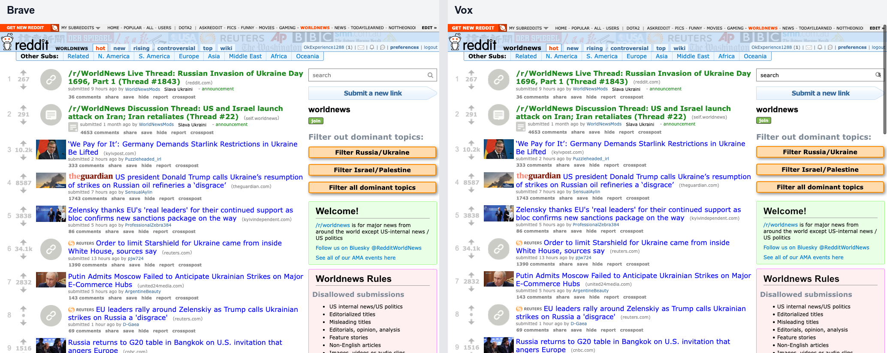

# Old Reddit rendering against Brave

**Exact Brave pixel equality remains unachieved.** The authenticated, frozen
1024×768 comparison differs at 141,439 of 786,432 pixels (17.9849%).
The comparison uses the native V renderer. No reference image is substituted
for the rendered page, and no existing screenshot tolerance is increased.



## Authentication

The account owner's existing Brave Reddit cookies were imported explicitly.
An isolated Brave instance decrypted only Reddit's copied cookie records;
the original Brave profile was left unchanged. An authenticated request to
`https://old.reddit.com/r/worldnews/` returned HTTP 200, and the native Vox
capture displayed the logged-in account and post thumbnails.

To refresh the imported session after signing in through Brave:

```sh
python3 tools/import_brave_reddit_session.py
open -n Build/v/Vox.app --args https://old.reddit.com/r/worldnews/
```

The importer writes `~/Library/Application Support/Vox/imported-cookies.txt`
with mode 0600. It does not print cookie values or access the account password.
Temporary Brave profiles are removed after use. The runtime reads this
Netscape-format jar on each request. `VOX_COOKIE_FILE` selects another jar;
an explicitly empty value disables import for that process.

Imported cookies retain domain/host-only, path, expiry, Secure and HttpOnly
attributes. Since Netscape files cannot retain SameSite or partition keys,
the importer excludes partitioned cookies and the runtime sends imported
cookies only in a same-site context. This is a read-only import, rather than
a complete persistent cookie store or a replacement for DOM cookie APIs.

## Implemented changes

- The HTTP compatibility adapter now sends an explicit Cookie header even
  when V's separate cookie map is empty. Duplicate cookie names and their wire
  order are retained.
- Native old.reddit.com documents select Chromium's default font-size keyword
  tables, including its 10px `x-small` size. Saved documents with an explicit
  old.reddit.com base URL use the same setting. Other documents retain the
  translated LibWeb defaults. The source of the compatibility tables is
  [Chromium FontSizeFunctions](https://chromium.googlesource.com/chromium/src/+/main/third_party/blink/renderer/core/css/font_size_functions.cc).
- HTML image requests are initialized even when the page has no JavaScript
  runtime. Existing hidden-image background preloads remain deferred until
  their transfers complete.
- A formatting context's positive margins overlap adjacent float intrusions
  on the corresponding side. Reddit's post text column consequently retains
  its missing 3px, restoring the reference headline wrapping. Focused Brave
  measurements also cover margins larger than the float, opposite-side
  margins, and negative margins. This is an intentional compatibility
  difference from the current upstream float width calculation.

## Comparison and remaining differences

The local evidence is under ignored `Build/reddit-parity/`, which has private
directory permissions because the captured page contains account information.
The reference is Brave 155.1.97.57. Both document captures use 1024×768 at
device scale 1 on the test display away from the pointer; browser chrome is
excluded.

The authenticated Brave DOM was frozen, executable script elements removed,
and its original document base URL installed. Both browsers render that same
HTML and its styles/resources. This removes changing post scores and timestamps
from the diagnostic; it does not establish equivalence of live script execution
or account interactions.

| Capture | Differing pixels | Percentage |
| --- | ---: | ---: |
| Before fixes | 254,304 | 32.3364% |
| Font sizes and static images | 173,668 | 22.0830% |
| Signed production, including float margins | 141,439 | 17.9849% |

`brave-frozen.png` and `vox-production.png` are the final reference and native
document captures; `production.diff.png`, `production.metrics.txt`, and
`production-result.json` retain the amplified differences and failed exact
verdict. The production output matches the corresponding development capture
exactly. Remaining differences include text rasterization and fractional line
geometry, control styling, and scrollbar presentation. A trial with rounded
text metrics increased the differing-pixel count and was reverted.

The zero-tolerance check exits 1 for the current pair:

```sh
python3 tools/check_pixel_equality.py \
  Build/reddit-parity/brave-frozen.png \
  Build/reddit-parity/vox-production.png \
  Build/reddit-parity/production.diff.png \
  --result Build/reddit-parity/production-result.json
```

The older `old-reddit-worldnews` site fixture remains an archived, logged-out
Ladybird comparison. Its reference and allowances have not been changed and
must not be used as evidence of Brave parity.

## Validation

The HTTP adapter's wire checks, four imported-cookie tests, three session
importer tests, two CSS font-policy tests, native navigation policy test,
three static-image tests, and three float-margin tests pass. Font policy,
static images, and float margins were also exercised with `-gc none`.
The existing formatting-context regression suite passes. The exact-pixel
gate's real PNG tests reject both a one-channel difference of 1 and an alpha
difference of 1. Signed production build and native startup smoke pass.
All eleven default screenshot smoke comparisons pass under their existing,
unchanged acceptance rules; these are separate from the failed Brave exact
comparison.
